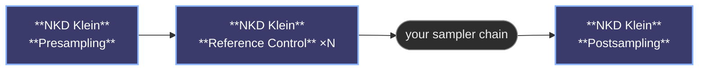

# NKD Klein Tools

ComfyUI nodes that turn a Flux Klein workflow into something simple. Plug in your model, drop an image, write a prompt, and go, with no manual wiring of internal pieces. Whether you want to generate from scratch, transform an existing photo, paint over a specific area, or zoom in for a high-detail touch-up, a couple of nodes handle it all. Optional extras let you build the prompt from curated presets, and control how much each reference image shows up, or which part of the canvas it lands on. It works with Klein 2 and with the new FLUX.3 Klein: a Model setting in Presampling shows only what applies to the one you use.

https://github.com/user-attachments/assets/f84cc919-325d-465b-8d3d-e178de5f7872


>   [**Full introduction tutorial**](https://youtu.be/8wBXI-QCy0w)

---

## What you can do with it

- Generate images from a prompt: connect the model and write what you want.
- Transform an existing image by dropping it into the reference slot and describing the change.
- Inpaint a specific area. Paint a mask and only the masked zone is regenerated, everything else stays untouched.
- Detail a small area at high quality. Turn on detailing to zoom into the masked zone (a face, a hand, an eye) and regenerate it with far more detail than a full-image pass gives you.
- Combine several reference images. Extra slots appear as you connect them.
- Dial each reference separately, or *(experimental)* send one to a specific area of the canvas.
- With Klein 3, connect the prompt upsampler and type a short request: Presampling turns it into the detailed prompt Klein 3 is built for, looking at your references and boxes. [Prompt upsampler](docs/nodes.md#prompt-upsampler-klein-3).
- With Klein 3, place, move, keep, remove or change things by drawing boxes right on your images, or let a detector (SAM3, YOLO…) find them so a workflow runs with nobody drawing. [How boxes work](docs/nodes.md#how-boxes-work-klein-3).

The node figures out which mode you're using based on what you connect, so there's no setting to flip.

---

## The nodes

| Node | What it does |
|---|---|
| [😺NKD Klein Presampling](docs/nodes.md#nkd-klein-presampling) | The starting point. Model, prompts and reference images go in here. Pick Klein 2 or Klein 3, and with Klein 3 draw boxes here. |
| [😺NKD Klein Postsampling](docs/nodes.md#nkd-klein-postsampling) | The end point. Delivers the final image and puts everything back after inpainting or detailing. |
| [😺NKD Klein Reference Control](docs/nodes.md#nkd-klein-reference-control) | The all-in-one reference dial, and the one to reach for today: strength, an optional per-step curve, and a zone if you give it a mask. *optional, experimental* |
| [😺NKD Klein Reference Weight](docs/nodes.md#nkd-klein-reference-weight) | The original strength-only node. Still works; Reference Control does everything it does. *optional* |
| [😺NKD Klein Reference Region](docs/nodes.md#nkd-klein-reference-region) | The regional half on its own, for when a Reference Weight node is already in the chain. *optional, experimental* |
| [😺NKD Klein Reference Fit](docs/nodes.md#nkd-klein-reference-fit) | Scales a reference so it sits inside the masked zone instead of stretching across the whole canvas. *optional, experimental* |
| [😺NKD Klein Prompt Builder](docs/nodes.md#nkd-klein-prompt-builder) | Builds a prompt from your own text plus curated preset dropdowns, with a live preview. *optional* |
| [😺NKD Klein Box Prompt](docs/nodes.md#nkd-klein-box-prompt-optional-klein-3) | Places, moves or removes things by bounding box (Klein 3). *optional* |
| [😺NKD Klein Box Detections](docs/nodes.md#nkd-klein-box-detections-optional-klein-3) | Turns what a detector found (a mask, SAM3 boxes, YOLO…) into things to remove, keep or change, with no drawing (Klein 3). *optional* |

**The chain looks like this:**



---

## Going further

| | |
|---|---|
| [The nodes in detail](docs/nodes.md) | What each node does, at length. |
| [Inputs and modes](docs/inputs.md) | Every input that changes the result, and the mode the node puts itself in when you connect one. |
| [Recipes and workflows](docs/recipes.md) | Settings that work, an example graph, and the order things go in. |
| [Changelog](docs/changelog.md) | What changed in each version. |

---

## Requirements

- ComfyUI with support for Flux Klein (Klein 2 or FLUX.3 Klein). Klein 3 was tested on ComfyUI 0.40.0.
- PyTorch ≥ 2.0

---

## Installation

Clone into your `ComfyUI/custom_nodes` folder:

```bash
git clone https://github.com/Nekodificador/ComfyUI-NKD-Klein-Tools
```

Or install via the ComfyUI Manager by searching for **NKD Klein Tools**.

## Credits

### Work this builds on

- [Black Forest Labs](https://docs.bfl.ai/flux_3/flux3_image_bounding_boxes) defines the box format Klein 3 reads, which the box editor and 😺NKD Klein Box Prompt write.
- The prompt upsampler uses the system prompts Black Forest Labs ships with [FLUX 3 Image Klein Prompt Upsampler](https://huggingface.co/black-forest-labs/flux-3-image-klein-pup) (Apache 2.0), bundled as `upsampler_prompts.json`.
- [black-forest-labs/skills](https://github.com/black-forest-labs/skills) (MIT) is where the prompt guidance behind 😺NKD Klein Prompt Builder comes from, its presets and its JSON layout.
- [ComfyUI-Flux2Klein-Enhancer](https://github.com/capitan01R/ComfyUI-Flux2Klein-Enhancer) is where the idea of dialing one reference's strength on its own comes from, which 😺NKD Klein Reference Weight and Reference Control build on.
- [differential-diffusion](https://github.com/exx8/differential-diffusion) is the soft-mask denoise schedule Presampling applies when you give it a mask, same behavior as core's DifferentialDiffusion node.
- Reinhard et al., *Color Transfer between Images* (2001), is the method behind Match Original Colors. Pérez, Gangnet and Blake, *Poisson Image Editing* (2003), is the one behind Seamless Edges, which runs through OpenCV.

## License

MIT

---

*Made by [Nekodificador](https://github.com/Nekodificador)*
