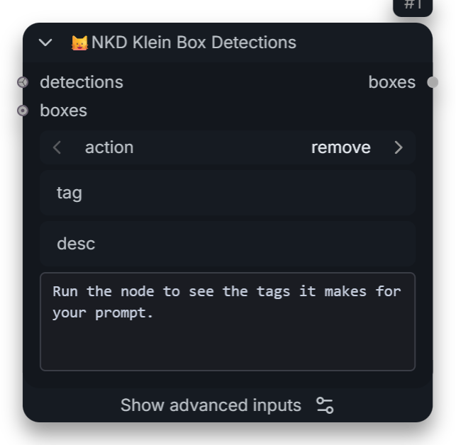

# 😺NKD Klein Box Detections

*optional, Klein 3*

Uses what a **detector** found instead of drawn boxes, so a workflow can remove or keep things with nobody in the loop. It has one input, **detections**, that takes any of these:

- A `MASK`: from SAM3, a segmenter, or one you painted. Each separate shape becomes one element; for objects that touch, use a mask batch with one mask per object (SAM3's *individual_masks*).
- A `BOUNDING_BOX`: from SAM3, RT-DETR or any node with that output. These boxes don't say how big the image was, so they're measured against the reference you give Presampling. Run the detector on that same image; if you resize it on the way (an upscale before Presampling), connect the detector's mask instead, which keeps working at any size.
- `SEGS`: from an Impact Pack detector (Ultralytics / YOLO).

Then pick one **action** for everything it found:

- *remove* erases it.
- *keep* holds it in place while the rest of the image changes.
- *new* has no source: `desc` is either new content for that spot or an instruction for what is already there ("Change the jacket to blue."). Use it to recolor or restyle what the detector found.

They work like the actions in the editor; see [How boxes work](presampling.md#how-boxes-work-klein-3). `desc` says what it is; leave it empty to use the detector's label.

**The tags.** Write a name in **tag**, like `dog`, and each element gets a tag for the prompt, numbered left to right: `<dog_1>`, `<dog_2>`. Chained nodes keep counting, so another node with `dog` carries on at `<dog_3>`. Leave it empty to use the detector's label (`<person_1>`), a short `desc`, or `<obj_1>`. Run the node (it can run on its own, before the rest of the workflow) and it lists its tags with their action, so you can copy them into your prompt. With the prompt upsampler you don't need them.

Chain one node per detection through **boxes**, each with its own action (remove every *dog*, keep the *person*), and connect the last one to Presampling's **boxes** input. They join the boxes drawn in the editor and follow the same rules, the detailing zoom included.

Run the detector on the image you give Presampling. If you detected on another reference than ref_0, set **reference** (under the node's advanced settings). For *keep* and *remove*, the canvas should have ref_0's shape (Aspect Ratio *As Reference*, or *Resize* off).

**The caption.** With the [prompt upsampler](presampling.md#prompt-upsampler-klein-3) connected, a short request ("remove the dog") is enough. Without it, any element whose `<id>` your prompt doesn't mention gets a sentence added for it ("In `<ref_image_0>`, remove the dog `<dog_1>` completely… Keep everything else in the image exactly unchanged."). That works most of the time, but saying what should fill the gap works better: "In `<ref_image_0>`, remove the dog `<dog_1>` and fill its place with empty sand." Once you mention an `<id>` yourself, nothing is added for it.

 

---

[← All NKD Klein Tools nodes](../README.md)
