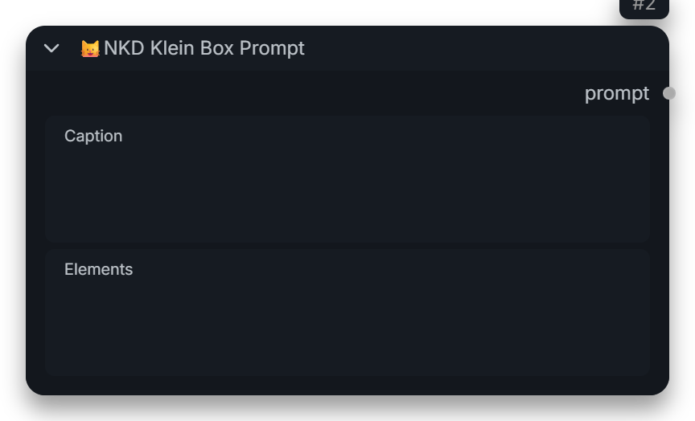

# 😺NKD Klein Box Prompt

*optional, Klein 3*




Places, moves or removes things by **bounding box**. Write a caption, then one line per element, and the node adds the layout list that Klein 3 reads; connect it to Presampling's positive input. (Presampling can also let you draw the boxes instead: see.) Boxes are `[top, left, bottom, right]` on a 0–1000 grid and guide placement and size. They are not a hard mask.

```
apple_1 from 1: A glossy red apple. | [158,140,908,860] -> [300,380,700,720]
cat_1 from 0: A tabby cat. | [265,40,855,400] -> remove
base_1 from 0: The background. | [0,0,1000,1000] -> keep
bird_1: A small bird. | -> [450,500,480,530]
sky_1: A pale sky. | [0,0,400,1000]
```

`from N` is the reference number (0 = ref_0). `-> remove` deletes the element, `-> keep` pins it in place, and a line with only a box places something new. In the caption, tag elements with `<id>` and refer to references as `<ref_image_0>`, `<ref_image_1>`… (counting from 0, like `from N`); see [Referring to your images in the prompt](inputs.md#referring-to-your-images-in-the-prompt).

<br clear="left">

---

[← All NKD Klein Tools nodes](../README.md)
