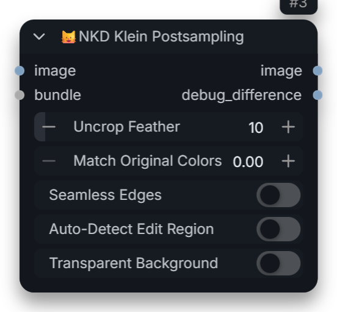

# 😺NKD Klein Postsampling

The end point. It takes the sampler's output and delivers the final image, putting everything back in its place when you've used inpainting or detailing.

 

---

[← All NKD Klein Tools nodes](../README.md)
