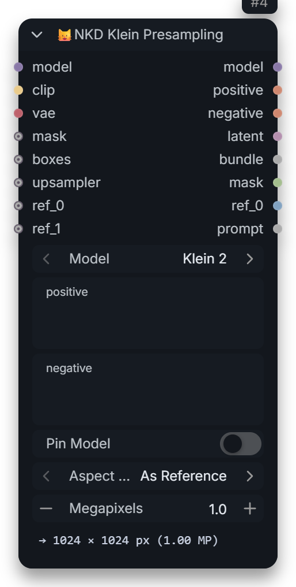
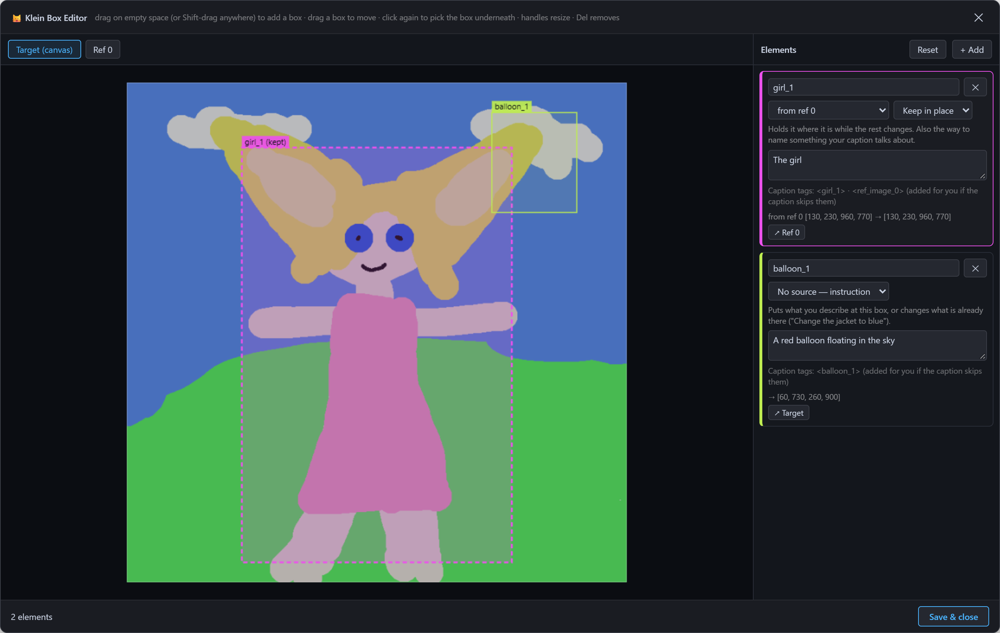

# 😺NKD Klein Presampling

The starting point. You connect your model, prompts, and reference image here. It hands off everything the sampler needs.

**Model** (the first setting) tells the node which Klein you use, so it only shows what applies: *Reference Strength* for Klein 2, and **✎ Draw boxes** for Klein 3.

### Prompt upsampler (Klein 3)

Klein 3 is built to read a long, planned prompt, and a short one typed as is gives generic results. The upsampler writes that long prompt for you. Load Black Forest Labs' upsampler (`qwen3.5_9b_flux3_prompt_upsampler`) with **Load CLIP** and connect it to Presampling's **upsampler** input. Your positive prompt becomes the request: "a man walking his dog, afternoon sun", "remove the dog", "put the apple from the second image in her hand".

- It sees every reference you connected, not just one, and with *Use Detailing* it sees the zoomed area the model gets.
- With boxes (drawn or from Box Detections) it plans the edit around them and keeps every box exactly where it is. It may add a few boxes of its own for things it decides to protect, such as the person next to what you remove.
- Without references it composes for your canvas shape.
- The **prompt** output shows the final text the model reads. Connect it to a text preview to see what the upsampler wrote.
- Any other instruct LLM loaded with Load CLIP also works, just not as well.
- **Upsample Prompt** (the last setting, Klein 3) turns it on and off without disconnecting anything, handy to compare your own prompt with the upsampled one.
- **Upsample Style** picks how much it adds. **Faithful** (default) keeps to what you wrote, fixes it up and lays it out clearly, adding only what the picture needs; complex scenes, counts and edits still come out right. **Full** is Black Forest Labs' original: it plans every detail you left open, so it may change the setting, invent props or decide what people look like.

It runs once per change and is cached like the rest of the node, but the first run takes a while and the 9B model needs memory of its own.

### How boxes work (Klein 3)

Each box element answers two questions: where does it come from, and what happens to it.

- With **no source**, the node puts what the description says at that box. That can be something new, or a change to what is already there: Black Forest Labs' own recolor examples work this way ("Change the jacket to blue.").
- **Move** takes it from its box on a reference and puts it at the Target box.
- **Keep** holds it where it is while the rest of the image changes. It's also how you tag something your caption only mentions, like the rock someone is standing on.
- **Remove** erases it.

Your positive prompt is the caption. Tag each element as `<id>` next to what it is, and images as `<ref_image_0>`, `<ref_image_1>`… counting from 0. If you leave an element untagged, the node adds a sentence for it in the form Klein 3 follows best ("In `<ref_image_0>`, remove the dog `<dog_1>` completely… Keep everything else in the image exactly unchanged."). Your own words still work better, above all for removals, where saying what fills the gap helps.

You can make elements three ways, and they all end up in the same list: draw them in the editor below, write them as lines in [Box Prompt](box-prompt.md), or build them from a detector with [Box Detections](box-detections.md). Box Detections and the editor can be used together.

### Drawing boxes (Klein 3)

Choose *Klein 3* and click **✎ Draw boxes** to place, move or remove things by drawing on your images. It uses the reference images you already connected to Presampling, so there is nothing else to wire. Your prompt stays your caption; the boxes are added to the end of it.

- **Drag on empty space** to add an element; drag a box to move it, use its handles to resize, press `Del` to remove it.
- Each element has a **source**: *No source* is a plain instruction at that box (add something here); a reference (*from ref 1*…) means "take it from there", and then you choose **Move**, **Keep in place** or **Remove**. Give it a short description.
- Use the tabs above the image to switch between **Target** (the output canvas) and each **Ref**: draw where something *comes from* on its reference, and where it *goes* on Target. You can start on either: draw on Target, pick the source reference on the card, and the **↗ Ref** button takes you there to draw the other half (a ⚠ on a tab means an element is still waiting for its box there).
- Images loaded with *Load Image* show up right away. For images **generated upstream**, run the workflow once (Presampling is an output node, so you can also run just up to it): the editor then shows what Presampling received.
- **Reset** (top of the list) removes every element and starts clean; it asks for a second click so a stray one can't wipe your work.
- **Target** follows the canvas you chose (*Aspect Ratio*, *Image Fit*, *Slide*), so what you draw is where it ends up.
- With a **mask and *Use Detailing***, draw on the whole image as usual. The node maps your boxes into the zoomed area; anything that falls outside it is skipped, with a note in the log.
- With a **mask and no detailing**, only the masked area changes, so keep your boxes inside it.
- In the caption, tag each element with `<id>` and refer to references as `<ref_image_0>`, `<ref_image_1>`… counting from 0, the same number as *from ref N* on the card (the card shows the tags to type). More in [Referring to your images in the prompt](inputs.md#referring-to-your-images-in-the-prompt).

Boxes guide placement and size; they are not a hard mask.

 

---

[← All NKD Klein Tools nodes](../README.md)
