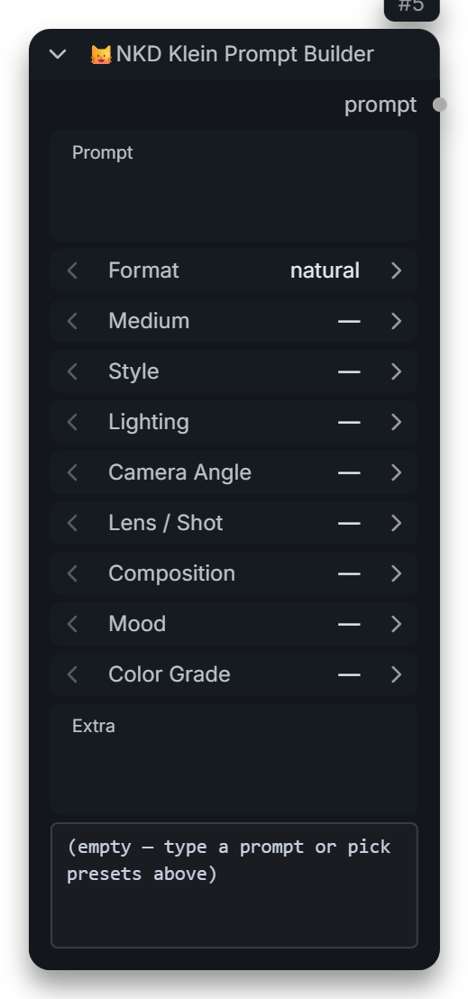

# 😺NKD Klein Prompt Builder

*optional*

Assembles a prompt from your own text plus curated preset dropdowns, with a live preview, and outputs a string you connect to Presampling's positive input. Choose flowing prose (best for Klein) or a structured JSON template. The dropdown presets live in `klein_presets.json`, edit that file (then restart ComfyUI) to customise them.

 

---

[← All NKD Klein Tools nodes](../README.md)
