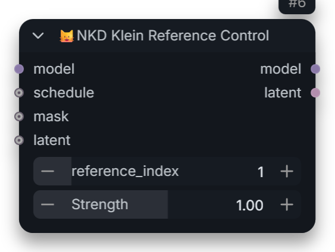

# 😺NKD Klein Reference Control

*optional, experimental*

The all-in-one reference dial, and the one to reach for if you're starting today. Sits between Presampling and your sampler and controls **one** reference image: how strongly it shows up, optionally over a per-step curve, and, if you connect a mask, **where** on the canvas it applies. Without a mask it's purely a strength control. Chain one node per reference. See [Controlling a single reference](inputs.md#controlling-a-single-reference).

 

---

[← All NKD Klein Tools nodes](../README.md)
