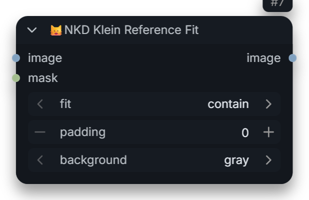

# 😺NKD Klein Reference Fit

*optional, experimental*

Goes **before** Presampling, not on the model line: scales a reference image so it sits inside the masked zone on a canvas-sized image. Klein stretches every reference across the whole canvas, so without this only the slice that happens to overlap your zone lands in it. Feed its `image` output into a reference slot of Presampling, and use the same mask in Reference Control / Reference Region.

 

---

[← All NKD Klein Tools nodes](../README.md)
