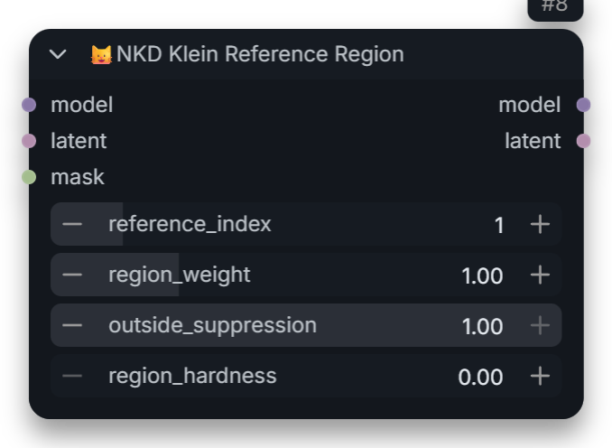

# 😺NKD Klein Reference Region

*optional, experimental*

The regional half on its own: confines one reference to a masked zone, without touching its overall strength. Use it when you already have a Reference Weight node in the chain and only want to add a zone. Reference Control merges the two.

 

---

[← All NKD Klein Tools nodes](../README.md)
