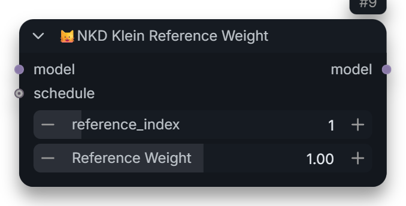

# 😺NKD Klein Reference Weight

*optional*

The original strength-only node: same model-line position, same `reference_index` + weight + optional curve, no regional part. Still here and still works. Reference Control does everything it does, so use that one for new graphs. See [Controlling a single reference](inputs.md#controlling-a-single-reference).

 

---

[← All NKD Klein Tools nodes](../README.md)
